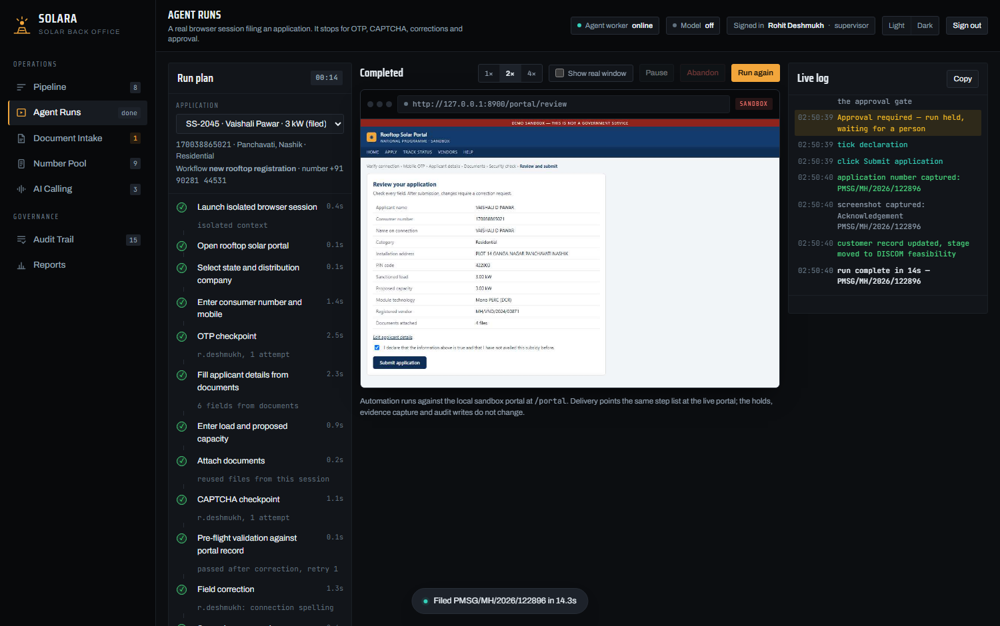
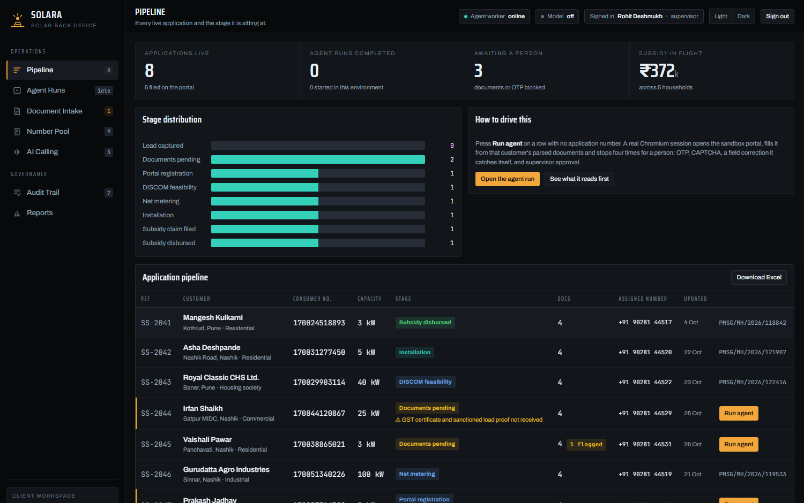
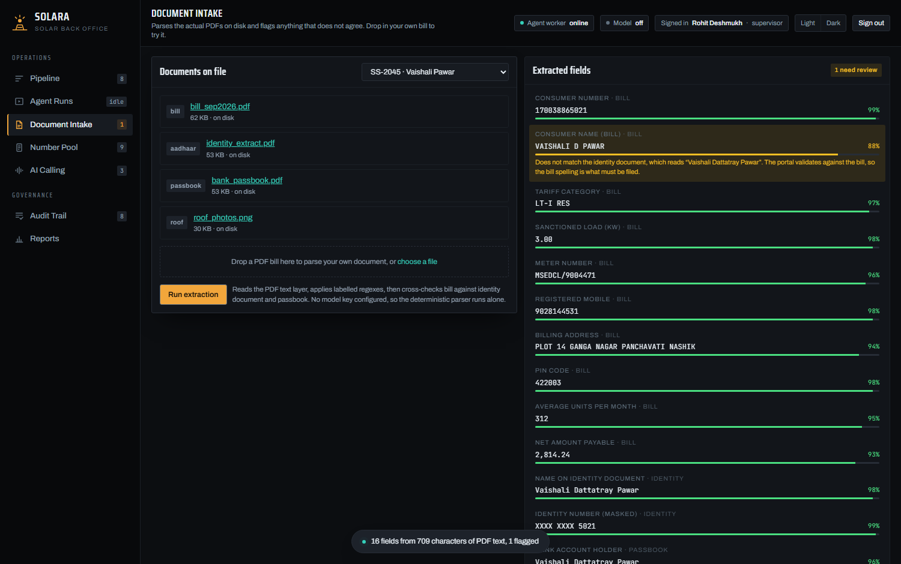
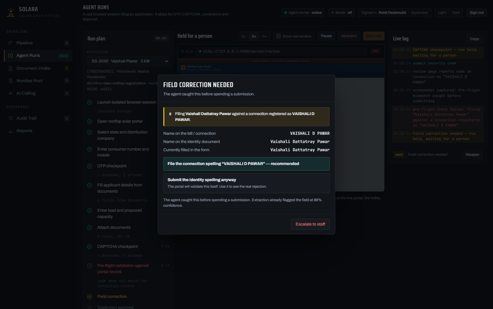

# Solara — Solar Back Office

Back-office automation for a solar EPC. Solara drives a real browser through a rooftop-solar
portal, reads the customer's documents, and stops for a human at every point where a human is
actually required — OTP, CAPTCHA, a field correction it catches itself, and a supervisor approval
without which nothing is ever filed.

It is a running application, not a prototype screen. The browser is Chromium under Playwright, the
form fills are keystrokes, the uploads are real PDFs, the screenshots are files on disk, and the
role checks are enforced by the server.

<p align="center">
  
</p>

---

## Contents

- [Why it looks like this](#why-it-looks-like-this)
- [Requirements](#requirements)
- [Installation](#installation)
- [Running it](#running-it)
- [Accounts and roles](#accounts-and-roles)
- [Guided walkthrough](#guided-walkthrough)
- [How it works](#how-it-works)
- [Project layout](#project-layout)
- [Configuration](#configuration)
- [Tests](#tests)
- [Pointing it at a different portal](#pointing-it-at-a-different-portal)
- [Troubleshooting](#troubleshooting)
- [What is real and what is not](#what-is-real-and-what-is-not)
- [Limitations](#limitations)

---

## Why it looks like this

Portal automation fails in predictable ways: a one-time password arrives on someone's phone, a
CAPTCHA appears, a name on the bill does not match the name on the identity document, a portal
field moves overnight. Solara is built around those failures rather than around the happy path.

- **It pauses instead of guessing.** Four checkpoints genuinely block the automation until a person
  answers. The OTP value is never written to the log or the database.
- **It catches its own mistakes.** Before submitting, the agent compares the name it is about to
  file against the connection record shown on the portal's own review page. If they differ it stops
  and asks, instead of burning a submission.
- **Nothing is filed without approval.** Only a supervisor can approve, and the API returns `403`
  to anyone else. It is not a disabled button.
- **Everything leaves evidence.** Every checkpoint and every failure writes a PNG screenshot linked
  to the run, and every decision writes an attributed row to an append-only audit table.

---

## Requirements

| | |
|---|---|
| Python | 3.11 or newer (developed on 3.14) |
| Disk | ~400 MB, mostly the Chromium build Playwright downloads once |
| OS | Windows, macOS or Linux. `run.bat` is the Windows convenience script |
| Network | Only for the one-time install. The application itself runs entirely on localhost |

No database server, no Node toolchain, no build step.

---

## Installation

### Windows

```bat
git clone https://github.com/LakshyaBetala/solar_energyyyyyy.git
cd solar_energyyyyyy
run.bat
```

`run.bat` installs the Python dependencies, downloads Chromium the first time, starts the server
and opens the browser.

### macOS and Linux

```bash
git clone https://github.com/LakshyaBetala/solar_energyyyyyy.git
cd solar_energyyyyyy

python3 -m venv .venv && source .venv/bin/activate
pip install -r requirements.txt
python -m playwright install chromium

python -m uvicorn app.main:app --host 127.0.0.1 --port 8900
```

Then open <http://127.0.0.1:8900>.

On first start Solara creates the database, generates the sample documents and runs extraction over
them. That takes a few seconds and happens once.

---

## Running it

```bash
python -m uvicorn app.main:app --host 127.0.0.1 --port 8900
```

| URL | |
|---|---|
| <http://127.0.0.1:8900> | the console |
| <http://127.0.0.1:8900/portal> | the sandbox portal the agent drives, if you want to click it yourself |
| <http://127.0.0.1:8900/api/docs> | interactive API reference |

To put the demo back to its opening state: **Reports → Reset the demo environment**, or
`python -m app.reset`.

---

## Accounts and roles

Password for all three is `demo`.

| Username | Role | Permitted |
|---|---|---|
| `r.deshmukh` | supervisor | everything, and the only role that may approve a filing |
| `s.kale` | operator | start, pause and abandon runs; enter OTP and CAPTCHA; correct fields |
| `a.more` | viewer | read only |

Roles are checked by the API on every mutating call, so the restriction holds whether the request
comes from the dashboard or from `curl`.

---

## Guided walkthrough

### 1. Pipeline

<p align="center">
  
</p>

Eight applications across the stages of a rooftop subsidy. The amber stripe marks rows that need a
person: SS-2047 is blocked on an OTP that never arrived, on a number that expires in three days.

### 2. Document Intake

<p align="center">
  
</p>

Select **SS-2045** and press **Run extraction**. Solara opens the PDF on disk, reads its text
layer, applies labelled patterns, then cross-checks the bill against the identity document and the
passbook.

One field comes back flagged at 88%: the bill reads `VAISHALI D PAWAR` while the identity document
reads `Vaishali Dattatray Pawar`. It does not pick a winner — it tells you, and explains that the
portal validates against the bill.

Drag your own PDF bill onto the drop zone to run the same pipeline over a real document.

### 3. Agent Runs

Select **SS-2045** and press **Start run**. A real Chromium session opens and the pane streams live
frames of it. Tick **Show real window** beforehand if you would rather watch the browser window
itself.

The run stops four times:

| Checkpoint | What happens |
|---|---|
| **OTP** | The portal really issued a code to the number dedicated to this registration. Read it from the inbox in the dialog. The value never reaches the run log. |
| **CAPTCHA** | The agent screenshots the challenge and asks a person. It makes no attempt to solve it. |
| **Correction** | Pre-flight check against the portal's own review page fails. Take the recommended option and it re-files; take *submit anyway* and the portal's validator rejects it with `VAL-0712` — a genuine server-side rejection, screenshotted. |
| **Approval** | Supervisor only. Sign in as `s.kale` and the server refuses. |

<p align="center">
  
</p>

The application number on the acknowledgement is **read off the portal page**, not generated. The
customer record advances to DISCOM feasibility and the audit trail records who approved what.

### 4. Reports

Download the Excel workbook (pipeline, numbers, runs and audit on four sheets) and the PDF run
report, which embeds the run's real screenshots alongside the step timings and the decisions.

---

## How it works

```
Browser ──► FastAPI ──┬── SQLite                      records, audit, evidence index
   ▲                  │
   │  SSE             ├── Playwright ──► Chromium ──► the portal, over HTTP
   │  steps, log,     │        │
   │  frames, holds   │        └─ holds: asyncio futures that block the run
   │                  │           until the API resolves them, role-checked
   └──────────────────┘
```

The agent is an async coroutine. Each checkpoint creates a row in `holds`, emits an event to the
dashboard, and awaits a future. `POST /api/runs/{id}/holds/{hold_id}` validates the caller's role,
resolves the future, and the coroutine continues. Pausing clears an `asyncio.Event` the agent
awaits before every action, so a pause takes effect between steps and never mid-keystroke.

A background task screenshots the live page a few times a second and pushes JPEG frames down the
same SSE stream, which is why the dashboard can show the browser without embedding one.

Runs belong to the process that started them. If the server restarts, any run left open is closed
out on boot and its checkpoints are cancelled, because a checkpoint nobody can answer would hang
the console forever.

### Selected endpoints

| Method | Path | Notes |
|---|---|---|
| `POST` | `/api/login` | session cookie |
| `GET` | `/api/bootstrap` | everything the dashboard needs in one call |
| `POST` | `/api/extract/{customer_id}` | operator; parses the PDFs on disk |
| `POST` | `/api/runs` | operator; starts an agent run |
| `GET` | `/api/runs/{id}/stream` | SSE: plan, steps, log, frames, holds |
| `POST` | `/api/runs/{id}/holds/{hold_id}` | resolves a checkpoint; role-checked per kind |
| `POST` | `/api/runs/{id}/pause` · `/resume` · `/stop` | operator |
| `GET` | `/api/exports/pipeline.xlsx` | real workbook |
| `GET` | `/api/exports/run/{id}.pdf` | real report with embedded screenshots |

Full reference at `/api/docs` while the server is running.

---

## Project layout

```
app/
  main.py          API, SSE stream, auth, static files
  portal.py        the sandbox portal: a real server-side web application
  agent/runner.py  the automation — steps, holds, evidence, retries
  extract.py       PDF parsing, cross-document rules, optional model pass
  docs_gen.py      generates the bill, identity, passbook and roof files
  exports.py       xlsx via openpyxl, pdf via Chromium print-to-PDF
  db.py            schema and seed data
  reset.py         returns the demo to its opening state
web/               dashboard — plain HTML, CSS and JavaScript, no build step
tests/
  smoke.py         drives the HTTP API through a full run, asserts on the database
  ui.py            drives the dashboard in a browser, asserts on what is on screen
docs/screenshots/  images used by this README
data/              database, documents, screenshots, exports (created at runtime)
```

---

## Configuration

Everything works with no configuration. For the optional model-assisted extraction, copy the
template and add one key:

```bash
cp .env.example .env
```

```ini
ANTHROPIC_API_KEY=...
# or
OPENAI_API_KEY=...
# optional, defaults to claude-sonnet-5-5 / gpt-4.1-mini
SOLARA_MODEL=claude-sonnet-5-5
```

With a key, extraction also sends the bill text to the model and merges its answer, marking any
field where the model and the parser disagree as needing review. Without one, the deterministic
parser runs alone and the header reads **Model off**, so it is always clear which path produced a
value. `.env` is gitignored.

Ports and timings live in `app/config.py`.

---

## Tests

Start the server, then in a second terminal:

```bash
python tests/smoke.py     # 30 checks — API, RBAC, a full agent run, portal validation, exports
python tests/ui.py        # 27 checks — sign-in, every view, a full run through the dialogs
```

Both reset to a clean state first and assert on what actually landed: that the application number
came off the portal page, that the operator's approval attempt was refused by the server, that the
screenshots exist on disk, that the workbook is a real `.xlsx` and the report a real `.pdf`, and
that the OTP value never appears in the run log.

---

## Pointing it at a different portal

Everything portal-specific is in two places:

- `app/config.py` → `PORTAL_URL`
- `app/agent/runner.py` → the `SEL` dictionary of CSS selectors, and `DOC_INPUTS`

The step list, the checkpoints, the retry logic, the evidence capture and the audit writes are
unchanged by a move. That separation is deliberate: when a portal relocates a field, you edit one
dictionary, and the screenshot captured at the failure tells you which entry.

---

## Troubleshooting

**`playwright._impl._errors.Error: Executable doesn't exist`**
Chromium was not downloaded. Run `python -m playwright install chromium`.

**Port 8900 already in use**
A previous server is still running. On Windows:
`netstat -ano | findstr :8900` then `taskkill /F /PID <pid>`.
On macOS or Linux: `lsof -ti:8900 | xargs kill -9`.

**The console opens on a checkpoint nobody started**
A run from an earlier session is still held. Press **Abandon**, or restart the server — orphaned
runs are closed out on boot.

**A run fails immediately with "no extraction on file"**
Open Document Intake for that customer and press **Run extraction** first. The agent fills the form
from extracted values, so it refuses to run without them.

**Extraction returns no fields**
The document has no text layer, which means it is a scan or a photograph. See
[Limitations](#limitations).

**Starting over completely**
Stop the server and delete the `data/` directory. Everything is regenerated on the next start.

---

## What is real and what is not

Real:

- Playwright drives Chromium against a web application served over HTTP; form fills are keystrokes.
- Extraction opens the PDFs on disk and parses them. Nothing is hard-coded.
- The portal validates server-side: unknown consumer numbers, wrong OTP (three attempts then
  lockout), wrong CAPTCHA, capacity above sanctioned load, missing documents, name mismatch, and
  duplicate applications.
- Checkpoints genuinely block the agent coroutine until someone resolves them with a sufficient
  role.
- Screenshots are PNG files; exports are a real `.xlsx` and a real `.pdf`.

Not real, and deliberately so:

- **The portal is a local sandbox**, not a government service. Every page says so.
- **AI calling** is recorded sample transcripts stored in the database. Live voice needs a telephony
  provider.
- **Numbers** are rows in a table. Real OTP delivery needs a number provider.
- **Documents** are generated samples. Drop in a real PDF to parse a real one.

---

## Limitations

- One run at a time per process, by design. Concurrency needs a worker queue.
- SQLite, single file. Multi-user needs PostgreSQL; the schema ports directly.
- Extraction reads a PDF text layer. Scanned or photographed bills need an OCR pass — Tesseract
  locally, or a vision model through the key above.
- Passwords are SHA-256 with a fixed prefix. Adequate for a local demo, not for production, which
  needs bcrypt or argon2 and server-side session storage.
- Sessions are held in process memory, so a restart signs everyone out.

---

© Lakshya Betala. All rights reserved.
