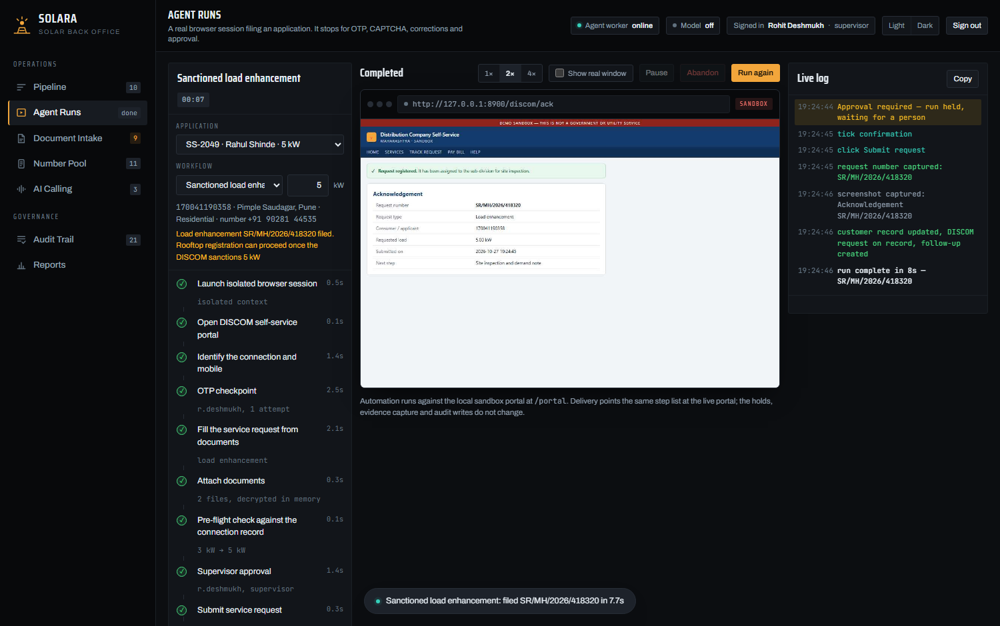

# Solara — Solar Back Office

Back-office automation for a solar EPC. Solara drives a real browser through the rooftop-solar
portal and a DISCOM self-service portal, reads the customer's documents, and stops for a person
at every point where one is actually required. Nothing is ever filed without a supervisor's
approval.

It is a running application, not a prototype screen. The browser is Chromium under Playwright,
the form fills are keystrokes, the uploads are real documents, the screenshots are captured from
the live page, documents are encrypted at rest, and role checks are enforced by the server.

<p align="center">
  
</p>

---

## Contents

- [What it does](#what-it-does)
- [Requirements](#requirements)
- [Installation](#installation)
- [Running it](#running-it)
- [Accounts and roles](#accounts-and-roles)
- [Guided walkthrough](#guided-walkthrough)
- [How it works](#how-it-works)
- [Security](#security)
- [Project layout](#project-layout)
- [Configuration](#configuration)
- [Tests](#tests)
- [Pointing it at the live portals](#pointing-it-at-the-live-portals)
- [Troubleshooting](#troubleshooting)
- [What is real and what is not](#what-is-real-and-what-is-not)
- [Limitations](#limitations)

Operations — users, backups, restore, keys — are in **[docs/OPERATIONS.md](docs/OPERATIONS.md)**.

---

## What it does

| Workflow | Portal | Human checkpoints |
|---|---|---|
| New rooftop registration | national rooftop-solar portal | OTP, CAPTCHA, field correction, approval |
| Sanctioned load enhancement | DISCOM self-service | OTP, approval |
| Sanctioned load reduction | DISCOM self-service | OTP, approval |
| New LT connection | DISCOM self-service | OTP, approval |

Around the workflows:

- **Document intake.** Reads bills, identity extracts, passbooks and ownership proofs, scores each
  field, cross-checks documents against each other, and flags disagreements instead of guessing.
- **It refuses work it knows will fail.** A plant larger than the sanctioned load, a commercial
  connection under a residential scheme, a duplicate filing, a load change with no connection.
- **Number pool.** One dedicated number per application, 90-day retention countdown, inbox,
  assignment, release, delivery tests.
- **Needs attention.** A follow-up list built from live data: expiring numbers, blocked
  applications, fields awaiting review, stopped runs.
- **Evidence and audit.** A screenshot at every checkpoint and every failure; an append-only,
  attributed audit trail, including refused attempts.
- **Exports.** A four-sheet Excel workbook and a PDF run report with the screenshots embedded.
- **Backups.** One click, consistent while running, documents still encrypted inside.

---

## Requirements

| | |
|---|---|
| Python | 3.11 or newer (developed on 3.14) |
| Disk | about 400 MB, mostly the Chromium build Playwright downloads once |
| OS | Windows, macOS or Linux. `run.bat` is the Windows one-click start |
| Network | only for the one-time install. The application runs entirely on localhost |

No database server, no Node toolchain, no build step.

---

## Installation

### Windows

```bat
git clone https://github.com/LakshyaBetala/solar_energyyyyyy.git
cd solar_energyyyyyy
run.bat
```

`run.bat` installs the Python dependencies, downloads Chromium the first time, starts the server
and opens the browser.

### macOS and Linux

```bash
git clone https://github.com/LakshyaBetala/solar_energyyyyyy.git
cd solar_energyyyyyy

python3 -m venv .venv && source .venv/bin/activate
pip install -r requirements.txt
python -m playwright install chromium

python -m uvicorn app.main:app --host 127.0.0.1 --port 8900
```

Then open <http://127.0.0.1:8900>.

The first start creates the database, generates the sample documents (encrypted), and runs
extraction over them. It takes a few seconds and happens once.

---

## Running it

```bash
python -m uvicorn app.main:app --host 127.0.0.1 --port 8900
```

| URL | |
|---|---|
| <http://127.0.0.1:8900> | the console |
| <http://127.0.0.1:8900/portal> | the rooftop-solar sandbox portal the agent drives |
| <http://127.0.0.1:8900/discom> | the DISCOM self-service sandbox portal |
| <http://127.0.0.1:8900/api/docs> | interactive API reference |

To return the demo to its opening state: **Reports → Reset the demo environment**, or
`python -m app.reset`.

---

## Accounts and roles

Password for all three is `demo`.

| Username | Role | Permitted |
|---|---|---|
| `r.deshmukh` | supervisor | everything; the only role that may approve a filing, create backups, reset |
| `s.kale` | operator | start, pause and abandon runs; enter OTP and CAPTCHA; correct fields; upload documents |
| `a.more` | viewer | read only |

Roles are checked by the API on every call. An operator *can* press Approve; the server refuses
it, and the refused attempt is written to the audit trail.

---

## Guided walkthrough

### 1. Pipeline

<p align="center">
  
</p>

Ten applications across the stages of a rooftop subsidy, from lead to disbursal. **Needs
attention** is derived from live data, worst first. Each row with agent work shows its next
workflow; SS-2044 is commercial, so it has none.

### 2. Document Intake

<p align="center">
  
</p>

Select **SS-2045** and press **Run extraction**. Solara decrypts the PDFs in memory, reads their
text layer, and cross-checks bill, identity extract and passbook. One field comes back flagged:
the bill reads `VAISHALI D PAWAR`, the identity document `Vaishali Dattatray Pawar`.

Drag your own PDF bill onto the drop zone to run the same pipeline over a real document.

### 3. Rooftop registration

Select **SS-2045** and press **Start run**. A Chromium session opens and the pane streams live
frames of it; tick **Show real window** to watch the browser itself.

| Checkpoint | What happens |
|---|---|
| **OTP** | The portal issues a code to the number dedicated to this application. A mistyped code is re-asked, as the portal allows; three wrong codes and the portal locks the session. |
| **CAPTCHA** | The agent screenshots the challenge and asks a person. It never tries to solve it. |
| **Correction** | Pre-flight check against the portal's own review page. Take the recommended option and it re-files. Choose *submit anyway* and the portal's own validator rejects it with `VAL-0712`, screenshotted, and the run recovers. |
| **Approval** | Supervisor only, enforced by the server. |

<p align="center">
  
</p>

The application number is **read off the acknowledgement page**. The customer moves to DISCOM
feasibility and the audit trail records who approved.

### 4. DISCOM service requests

Try SS-2049 on rooftop registration first: Solara refuses, because the 5 kW plant exceeds the
3 kW sanctioned load. Its next step is a **load enhancement**, which runs on the DISCOM portal
with an OTP and an approval, and comes back with a request number. SS-2050 has no connection at
all, so its workflow is a **new connection**, filed from the identity document and ownership proof.

<p align="center">
  
</p>

### 5. Reports

The Excel workbook covers pipeline, numbers, runs and audit. The PDF run report covers every step,
every checkpoint and who resolved it, with the run's screenshots embedded. Supervisors can create a
backup from here.

---

## How it works

```
Browser ──► FastAPI ──┬── SQLite ─────────────── records, audit, evidence index
   ▲                  ├── vault ──────────────── documents and screenshots, encrypted at rest
   │  SSE             └── Playwright ──► Chromium ──► rooftop portal  /  DISCOM portal
   │  plan, steps,              │
   │  log, frames,              └─ checkpoints: asyncio futures that block the run
   │  checkpoints                  until the API resolves them, role-checked
   └──────────────────────────────────────────────┘
```

Each workflow is a list of steps plus a map of the portal's fields. The agent is an async
coroutine. A checkpoint writes a row to `holds`, emits an event, and awaits a future;
`POST /api/runs/{id}/holds/{hold_id}` checks the caller's role and resolves it. Pausing clears an
event the agent awaits before every action, so a pause lands between steps, never mid-keystroke.

A background task screenshots the live page a few times a second and streams JPEG frames on the
same SSE connection. That is how the console shows the browser without embedding one.

A run belongs to the process that started it. If the server restarts, open runs are closed out on
boot and their checkpoints cancelled; nothing is submitted.

### Selected endpoints

| Method | Path | Notes |
|---|---|---|
| `POST` | `/api/login` | session stored server-side |
| `GET` | `/api/bootstrap` | everything the console needs, in one call |
| `GET` | `/api/followups` | the Needs attention list |
| `POST` | `/api/extract/{customer_id}` | operator; parses the documents on disk |
| `POST` | `/api/runs` | operator; `{customer_id, workflow?, target_kw?}` |
| `GET` | `/api/runs/{id}/stream` | SSE: plan, steps, log, frames, checkpoints |
| `POST` | `/api/runs/{id}/holds/{hold_id}` | resolves a checkpoint; role-checked per kind |
| `POST` | `/api/runs/{id}/pause` · `/resume` · `/stop` | operator |
| `GET` | `/api/exports/pipeline.xlsx` | workbook |
| `GET` | `/api/exports/run/{id}.pdf` | run report with screenshots |
| `POST` | `/api/backup` | supervisor |

Full reference at `/api/docs` while the server is running.

---

## Security

| Control | Implementation |
|---|---|
| Documents and screenshots at rest | Fernet (AES-128-CBC + HMAC-SHA256), key in `data/vault.key` or `SOLARA_VAULT_KEY` |
| File access | `/files/...` requires a signed-in session; every document view is audited |
| Passwords | salted scrypt, constant-time comparison |
| Sessions | random 256-bit tokens stored server-side; `HttpOnly`, `SameSite=Lax` |
| Roles | checked by the API on every mutating call; refused attempts are audited |
| OTP values | written only to the SMS table the portal uses; never to run logs or audit |
| Backups | consistent SQLite snapshot plus encrypted files; the key is deliberately excluded |
| Network | binds to `127.0.0.1` by default |

---

## Project layout

```
app/
  main.py          API, SSE stream, auth, follow-ups, files, backups
  agent/runner.py  the automation: workflows, checkpoints, retries, evidence, refusal guards
  portal.py        sandbox rooftop-solar portal, a real server-side web app
  discom.py        sandbox DISCOM self-service portal: new connection, load change
  extract.py       document parsing, cross-document rules, optional model pass
  vault.py         encryption at rest
  docs_gen.py      generates the sample bills, identity extracts, passbooks, ownership proofs
  exports.py       xlsx via openpyxl, pdf via Chromium print-to-PDF
  backup.py        consistent backups
  db.py            schema and seed data
  reset.py         returns the demo to its opening state
web/               console — plain HTML, CSS and JavaScript, no build step
tests/
  smoke.py         56 checks through the HTTP API, asserting on the database and the disk
  ui.py            37 checks driving the console in a real browser
docs/              OPERATIONS.md and the screenshots used here
data/              database, encrypted documents and screenshots, exports, backups (created at runtime)
```

---

## Configuration

Everything works with no configuration. For the optional model-assisted extraction:

```bash
cp .env.example .env
```

```ini
ANTHROPIC_API_KEY=...
# optional model override
SOLARA_MODEL=claude-sonnet-5-5
```

With a key, extraction also sends the bill text to the model and marks any field where the model
and the parser disagree. Without one, the deterministic parser runs alone and the header reads
**Model off**, so it is always clear which path produced a value. `.env` is gitignored.

Ports and timings live in `app/config.py`.

---

## Tests

Start the server, then in a second terminal:

```bash
python tests/smoke.py     # 56 checks: access control, encryption, extraction, refusal guards,
                          # rooftop runs (including a mistyped OTP and a real portal rejection),
                          # all three DISCOM workflows, follow-ups, exports, backups, pause, abandon
python tests/ui.py        # 37 checks: every view, runs started from the pipeline, a refused
                          # approval, a DISCOM run, dismissable checkpoints, light theme, phone width
```

Both reset the demo before and after, and assert on what actually landed: the application number
came off the portal page, the operator's approval was refused by the server, documents on disk are
ciphertext, the backup holds no key, and no OTP value appears in any log.

---

## Pointing it at the live portals

Everything portal-specific is in two places:

- `app/config.py` → `PORTAL_URL`, `BASE_URL`
- `app/agent/runner.py` → the `SEL` / `DSEL` field maps and `DOC_INPUTS` / `DDOC_INPUTS`

The step lists, checkpoints, retries, evidence capture, refusal guards and audit writes do not
change. When a portal moves a field you edit one map, and the screenshot taken at the failure
shows which entry.

---

## Troubleshooting

**`Executable doesn't exist` from Playwright** — run `python -m playwright install chromium`.

**Port 8900 already in use** — a previous server is still running. Windows:
`netstat -ano | findstr :8900` then `taskkill /F /PID <pid>`. macOS/Linux:
`lsof -ti:8900 | xargs kill -9`.

**The console opens on a checkpoint nobody started** — a run from an earlier session is still
held. Press **Escape**, then **Abandon**, or restart the server.

**"no extraction on file"** — open Document Intake for that customer and press **Run extraction**.

**A run is refused before it starts** — that is a guard, not a fault. The message says why: wrong
workflow for the customer, plant larger than the sanctioned load, already filed, and so on.

**`InvalidToken` when opening documents** — `data/vault.key` is missing or is not the key the
files were encrypted with. Restore the right key; see [OPERATIONS.md](docs/OPERATIONS.md).

**Starting over completely** — stop the server and delete `data/`. Everything is regenerated.

---

## What is real and what is not

Real:

- Playwright drives Chromium against web applications served over HTTP.
- Extraction decrypts and parses the documents on disk; nothing is hard-coded.
- Both portals validate server-side: unknown consumers, wrong OTPs with lockout, wrong CAPTCHAs,
  capacity above sanctioned load, enhancements that do not increase load, missing documents, name
  mismatches, duplicates.
- Checkpoints genuinely block the agent until resolved with a sufficient role.
- Encryption, sessions, backups and exports are real.

Not real, deliberately:

- **The portals are local sandboxes.** Every page says so.
- **AI calling** is recorded sample transcripts. Live voice needs a telephony provider.
- **Numbers** are rows in a table. Real OTP delivery needs SIMs or a relay.
- **Documents** are generated samples. Drop in a real PDF to parse a real one.

---

## Limitations

- One run at a time per process, by design. Concurrency needs a worker queue.
- SQLite in a single file. Multi-user needs PostgreSQL; the schema ports directly.
- Extraction reads PDF text layers. Scans and photos need an OCR pass or the vision path.
- The vault key sits in `data/` beside the data. That protects copies and backups, not a
  compromised machine; production keeps it in Windows' protected storage.

---

© Lakshya Betala. All rights reserved.
